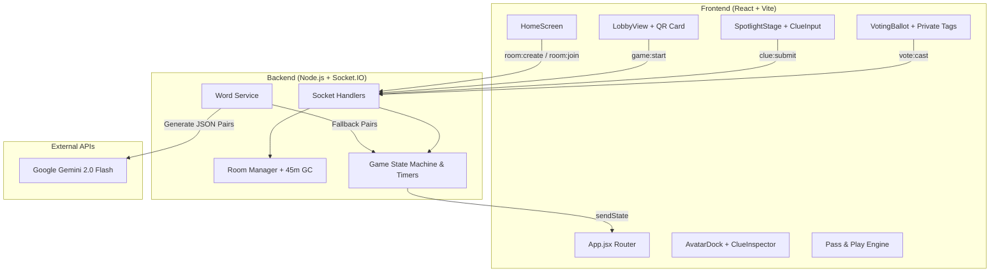

# 🕵️ Undercover Party V2

A real-time multiplayer social deduction word party game built with **React**, **Node.js**, **Socket.IO**, and **Google Gemini API**.

[](https://react.dev/)
[](https://vitejs.dev/)
[](https://socket.io/)
[](https://nodejs.org/)
[](https://ai.google.dev/)

---

## 🎮 Overview & Game Flow

In **Undercover Party**, players gather in a secret room. Most players are **Innocents** who receive the same secret word. One or more players are **Undercovers** who receive a slightly different, closely related word. Up to two players can be **Strangers**—outsiders who receive **no word at all** and must bluff blindly!

### The Three Roles

| Role | Secret Word | Objective |
|---|---|---|
| 😇 **Innocent** | Normal Word (e.g. *"Coffee"*) | Give subtle clues, identify the infiltrators, and vote them out. |
| 🕵️ **Undercover** | Variant Word (e.g. *"Tea"*) | Blend in, figure out the Innocents' word, and survive until equal numbers. |
| 👤 **Stranger** | No Word (`???`) | Bluff based purely on others' clues. If eliminated, guess the Innocent word to steal the win! |

---

## 🚀 Key Features

* **🌟 Center Spotlight Stage**: Turn-based interactive clue giving where the active player takes center stage with a glowing spotlight and timer ring.
* **🕵️ Private Detective Notebook**: Tap any player's avatar in the bottom dock to inspect their clues and tag your private hunch (`🟢 Safe`, `🤔 Unsure`, `🚩 Sus`). Notes stay 100% private in `sessionStorage` and appear on your voting ballot in parentheses.
* **🎯 Fixed Capacity Rooms & Sliders (3–10 Players)**: Rooms are locked to a target count (e.g. 6 players) and start only when full. Dynamic sliders auto-enforce role balance ($\text{Special Roles} < \frac{N}{2}$).
* **🤖 Gemini AI Word Generation**: Dynamically creates 15–20 creative word pairs per room across topics (*Food*, *Movies*, *Gaming*, *Sports*, *Travel*, *Tech*, *Random*) with zero-crash fallback to 50+ curated offline pairs.
* **📱 Native QR Code Joining**: Instant lobby QR code for camera scanning (`?join=XXXX`), with zero external app or permission overhead.
* **🔄 Pass & Play (Offline Mode)**: Play on a single phone passed around the circle with an allotted 1–20 pass code and a **Hold-to-Reveal** privacy cover.
* **⏱️ Server-Authoritative Timers**: 4 clue timer presets (20s, 30s, 45s, 60s) and round timers with auto-skip and random vote fallbacks.

---

## 🏗️ Architecture



---

## 🛠️ Getting Started

### Prerequisites
* **Node.js 20+**
* **npm**

### Quick Start (Local Monorepo)

```bash
# 1. Install all dependencies
npm install

# 2. (Optional) Set up your Gemini API key in a .env file
echo "GEMINI_API_KEY=your_key_here" > .env

# 3. Run client and server concurrently
npm run dev
```

Open `http://localhost:5173` in your browser. To test multiple players, open additional tabs or incognito windows.

---

## 🌐 Production Deployment

### 1. Backend (Render / Railway / Fly.io)
* **Root Directory**: `server`
* **Build Command**: `npm install`
* **Start Command**: `npm start`
* **Environment Variables**:
  * `CLIENT_ORIGIN`: Your frontend URL (e.g. `https://your-game.vercel.app`)
  * `GEMINI_API_KEY`: (Optional) Your Google Gemini API key

### 2. Frontend (Vercel / Netlify / Cloudflare Pages)
* **Root Directory**: `client`
* **Framework**: Vite
* **Build Command**: `npm run build`
* **Output Directory**: `dist`
* **Environment Variables**:
  * `VITE_SERVER_URL`: Your deployed backend service URL (e.g. `https://your-game-api.onrender.com`)
